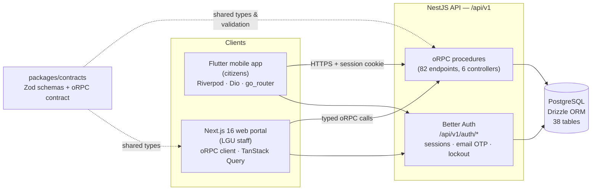

# iGubat

**A proposed digital services platform for the Municipality of Gubat, Sorsogon (Philippines).**

> **Status: proposal / prototype — not in production.** iGubat is not an official LGU service
> and is not currently deployed for public use. All accounts, records, and content in a local
> setup come from the development seed script.

iGubat brings common municipal transactions online. Citizens use a **Flutter mobile app** to request
services, report community issues, and receive announcements. LGU staff use a **Next.js web portal**
to process those requests, publish content, and audit activity. Both clients talk to a single
**NestJS API** backed by **PostgreSQL**.

---

## Contents

- [Who uses it](#who-uses-it)
- [Features](#features)
- [Architecture](#architecture)
- [Tech stack](#tech-stack)
- [By the numbers](#by-the-numbers)
- [Getting started](#getting-started)
- [Environment variables](#environment-variables)
- [Running the apps](#running-the-apps)
- [Testing](#testing)
- [Continuous integration](#continuous-integration)
- [Project structure](#project-structure)
- [Screenshots](#screenshots)
- [Status & roadmap](#status--roadmap)

---

## Who uses it

| Audience              | Client                                  | Roles (`users.role` in `packages/db/src/schema.ts`)                                  |
| --------------------- | --------------------------------------- | ------------------------------------------------------------------------------------ |
| Residents / guests    | Flutter mobile app                      | `registered_citizen` (guests can browse public content without an account)           |
| LGU operational staff | Next.js web portal — **Moderator** view | `frontline_officer`, `department_supervisor`, `content_editor`, `emergency_operator` |
| LGU administrators    | Next.js web portal — **Admin** view     | `ict_admin`, `super_admin`                                                           |

- The web portal maps the six staff roles to two portal roles, Moderator and Admin
  (`apps/web/core/lib/roles.ts`).
  - Citizens who sign in to the portal are signed straight back out.
  - Admin-only pages are User Management, Analytics, Audit Logs, and Settings.
- The API enforces the same split server-side:
  - Staff-only operations reject non-staff with `403`.
  - Audit logs, staff and citizen management, analytics, and settings require an admin role
    (`apps/backend/src/modules/v1/igubat/igubat.service.ts`).

---

## Features

Every item below is backed by API procedures in `packages/contracts` and implemented in `apps/backend`.

- **Service requests with status tracking**
  - Citizens submit a request for a service type, with up to 3 attachments, and get a tracking number.
  - Statuses: `pending`, `in_review`, `approved`, `rejected`, `for_pickup`, `completed`.
  - Every change writes a status-history row and notifies the citizen in-app.
  - Citizens can cancel a request while it is still `pending`.
- **Community issue reports**
  - Categories: Road Damage, Flooding, Waste Management, Street Lighting, Public Safety, Others.
  - Optional barangay and location, plus up to 3 attachments.
  - Statuses: `received`, `in_progress`, `resolved`, `closed`, each recorded in a status history.
  - History rows are `public` or `internal`, and citizens only see public entries.
- **News and events:** staff publish articles and events, and the citizen home screen shows featured placements.
- **Discover Gubat:** a directory of tourist spots, festivals and culture, and local products, with photos. Staff manage it with draft, publish, archive and delete.
- **Transparency disclosures:** public documents and projects with attachments. Staff can draft, publish, archive and export to CSV.
- **Emergency directory and broadcasts:** a hotline directory, and staff-created emergency broadcasts that can be sent now or scheduled.
- **Notifications:** an in-app notification feed with read/unread state and per-category notification preferences.
- **Audit logs:**
  - Request and report creation, cancellation, status changes, and staff account creation append to `audit_logs`.
  - Only admins can view the log.
- **Account security:**
  - Email/password sign-in through Better Auth, with email OTP verification for new citizen accounts.
  - Optional Google sign-in.
  - The account locks for 15 minutes after 5 consecutive wrong passwords (`packages/auth/src/lockout.ts`).
- **Community dashboard, help articles, and policy documents** for citizens. Staff get an analytics summary.

---

## Architecture



- **Contract-first API:**
  - Each route is an oRPC procedure defined once in `packages/contracts`, using Zod for input and output.
  - The backend implements it with `@Implement(...)` (`@orpc/nest`).
  - The web portal calls it through a typed client.
  - The mobile app calls the same REST paths through Dio.
- **Auth:**
  - Better Auth runs inside the NestJS app at `/api/v1/auth/*` and stores data through the Drizzle adapter.
  - A global guard protects routes unless they are marked `@AllowAnonymous()`.
- **API docs:** the OpenAPI spec is served at `/api/v1/spec.json`, with a Scalar UI at `/api/v1/docs`.

---

## Tech stack

| Layer      | Technology                                                                                      |
| ---------- | ----------------------------------------------------------------------------------------------- |
| Monorepo   | Turborepo, pnpm workspaces (Node ≥ 22.20, pnpm ≥ 10.15)                                         |
| Mobile app | Flutter (Dart SDK ^3.9.2), Riverpod 3, go_router, Dio, fpdart                                   |
| Web portal | Next.js 16, React 19, Tailwind CSS 4, shadcn/ui, TanStack Query & Form                          |
| API        | NestJS 11, oRPC (`@orpc/nest`), nestjs-zod                                                      |
| Contracts  | Zod 4, `@orpc/contract`                                                                         |
| Database   | PostgreSQL, Drizzle ORM (1.0 beta), drizzle-kit migrations                                      |
| Auth       | Better Auth 1.4 (email/password, email OTP, Google)                                             |
| Testing    | Jest (API), Vitest + Testing Library (web, contracts, auth), Playwright (web e2e), flutter_test |
| CI         | GitHub Actions                                                                                  |

---

## By the numbers

Counted from the source on this branch:

| What                            | Count                                          | Source                                             |
| ------------------------------- | ---------------------------------------------- | -------------------------------------------------- |
| Database tables                 | **38**                                         | `createTable(...)` in `packages/db/src/schema.ts`  |
| SQL migrations                  | 5                                              | `packages/db/src/migrations/`                      |
| API endpoints (oRPC procedures) | **82** across 6 controllers                    | `@Implement(...)` in `apps/backend/src`            |
| Flutter screens                 | **26** screen files (28 screen widget classes) | `apps/mobile/lib/features/*/presentation/screens/` |
| Web portal admin pages          | 17 route folders                               | `apps/web/app/(admin)/`                            |
| Automated tests run in CI       | **223**                                        | see [Testing](#testing)                            |

---

## Getting started

### Prerequisites

- Node.js ≥ 22.20 and pnpm ≥ 10.15 (`corepack enable` picks up the pinned pnpm version).
- A PostgreSQL database that you provide. `docker-compose.yml` runs only the web and backend containers.
- Flutter SDK (stable channel) to run or test the mobile app.

### Setup

```bash
pnpm install

# Copy env templates and fill in real values (see "Environment variables")
cp apps/backend/.env.example apps/backend/.env
cp apps/web/.env.example     apps/web/.env
cp packages/db/.env.example  packages/db/.env
cp apps/mobile/.env.example  apps/mobile/.env

# Build shared packages (contracts, db, auth) once
pnpm build

# Create the schema
pnpm db:migrate        # or: pnpm db:push (dev only)

# Optional: load development seed data (barangays, services, sample content, demo accounts)
pnpm db:seed
```

> **Seed accounts:** `packages/db/src/seed.ts` creates demo citizen and staff accounts with one
> shared development password defined in that file. Treat them as local-only. Change or remove them
> before any shared, staging, or public deployment.

---

## Environment variables

Templates live next to each app. Values below are placeholders. Never commit real secrets.

| File                | Variable                                   | Purpose                                                                         |
| ------------------- | ------------------------------------------ | ------------------------------------------------------------------------------- |
| `apps/backend/.env` | `NODE_ENV`, `PORT`                         | Runtime mode and API port (default `3000`)                                      |
|                     | `CORS_ORIGINS`                             | Comma-separated allowed origins (e.g. the web portal URL)                       |
|                     | `DATABASE_URL`                             | `postgresql://<user>:<password>@<host>:5432/<db>`                               |
|                     | `BETTER_AUTH_SECRET`                       | Long random string used to sign sessions                                        |
|                     | `BETTER_AUTH_TRUSTED_ORIGINS`              | Comma-separated origins allowed to call auth endpoints                          |
|                     | `BETTER_AUTH_COOKIE_DOMAIN`                | Optional, for cross-subdomain cookies                                           |
|                     | `GOOGLE_CLIENT_ID`, `GOOGLE_CLIENT_SECRET` | Optional, for Google sign-in                                                    |
| `apps/web/.env`     | `NEXT_PUBLIC_APP_URL`                      | Portal URL (dev: `http://localhost:3001`)                                       |
|                     | `NEXT_PUBLIC_API_BASE_URL`                 | API base (dev: `http://localhost:3000/api`)                                     |
|                     | `NEXT_PUBLIC_API_VERSION`                  | `v1`                                                                            |
| `packages/db/.env`  | `DATABASE_URL`                             | Used by drizzle-kit and the seed script                                         |
| `apps/mobile/.env`  | `API_BASE_URL`                             | API base as seen from the device (Android emulator: `http://10.0.2.2:3000/api`) |
|                     | `API_VERSION`                              | `v1`                                                                            |

Optional variables for Playwright e2e are listed under [Testing](#testing).

---

## Running the apps

```bash
pnpm dev               # everything (turbo watch)
pnpm dev:backend       # API on http://localhost:3000  (docs: /api/v1/docs)
pnpm dev:web           # staff portal on http://localhost:3001
pnpm dev:mobile-get    # flutter pub get
pnpm dev:mobile-run    # flutter run (needs an emulator/device and apps/mobile/.env)
```

Other useful scripts: `pnpm db:studio` (Drizzle Studio), `pnpm lint`, `pnpm typecheck`, `pnpm format`.

---

## Testing

None of the suites below need a deployed environment, and they run in CI:

| Suite                                          | Runner                   | Tests          | Command                          |
| ---------------------------------------------- | ------------------------ | -------------- | -------------------------------- |
| API unit (`apps/backend`)                      | Jest                     | 33 in 4 files  | `pnpm -F @repo/backend test`     |
| Auth lockout (`packages/auth`)                 | Vitest                   | 8 in 1 file    | `pnpm -F @repo/auth test`        |
| Contracts / Zod schemas (`packages/contracts`) | Vitest                   | 71 in 3 files  | `pnpm -F @repo/contracts test`   |
| Web portal (`apps/web`)                        | Vitest + Testing Library | 87 in 15 files | `pnpm -F @repo/web test`         |
| Mobile (`apps/mobile`)                         | flutter_test             | 24 in 13 files | `cd apps/mobile && flutter test` |

Run all JS/TS suites with `pnpm test` (or `pnpm test:cov` for coverage).

What the key tests prove:

- **`apps/backend/src/modules/v1/igubat/igubat.service.spec.ts`** uses a mocked Drizzle client and covers:
  - staff-vs-citizen and admin-only checks;
  - request and report status changes, each writing a history row, a citizen notification, and an audit-log entry;
  - only `pending` requests can be cancelled;
  - citizens never see `internal` history entries.
- **`packages/auth/src/lockout.test.ts`** covers the lockout policy (5 failures lead to a 15-minute lock, which then expires and resets) and the Better Auth sign-in hooks:
  - a locked account gets `429`;
  - unverified-email (`403`) failures are not counted.
- **`packages/contracts/.../requests-reports.schema.test.ts`** checks which service-request and citizen-report payloads the schemas accept and reject.
- **`apps/web/features/auth/login/components/login-form.test.tsx`** covers the staff login form:
  - staff are sent to `/dashboard`;
  - citizens are signed out and shown the staff-only message;
  - server errors, including the lockout message, are displayed;
  - schema validation runs before the API is called.
- **`apps/mobile/test/login_screen_test.dart`** and **`report_issue_screen_test.dart`** are widget tests that use fake repositories to check:
  - form validation;
  - the exact payload sent to the API;
  - success and failure messages.

### Web end-to-end (Playwright)

`packages/e2e-web` has 36 Playwright tests. They need a running web app at `BASE_URL` (default
`http://localhost:3001`). Tests that need a backend skip themselves unless the matching variables
are set:

```bash
# UI-only tests (web app running locally)
pnpm test:e2e:web

# Staff login against a real backend + seeded DB (credentials from your environment, never committed)
E2E_STAFF_EMAIL=<staff email> E2E_STAFF_PASSWORD=<password> pnpm test:e2e:web

# Authenticated-session suite
E2E_AUTH_API_URL=http://localhost:3000/api/v1/auth/ E2E_TEST_EMAIL=<email> E2E_TEST_PASSWORD=<password> pnpm test:e2e:web
```

The staff-login test never submits wrong passwords, so running it doesn't push the shared account
toward lockout.

---

## Continuous integration

`.github/workflows/ci.yml` runs on pushes and pull requests to `dev`, `staging`, and `production`.

| Job                          | What it does                                                                                                       |
| ---------------------------- | ------------------------------------------------------------------------------------------------------------------ |
| **Lint and Typecheck**       | `pnpm install --frozen-lockfile`, `pnpm typecheck`, `pnpm lint`, `pnpm format`                                     |
| **Unit Tests**               | `turbo test:cov` for API, auth, contracts, and web (affected packages only on PRs), with a coverage comment on PRs |
| **Flutter (analyze + test)** | `flutter pub get`, `flutter analyze`, `flutter test` (Flutter SDK and pub cache cached)                            |
| **E2E Tests (Web)**          | Builds the portal and runs Playwright UI tests; the backend-dependent tests skip                                   |

The pnpm store is cached by lockfile hash. Deployment lives in separate workflows
(`deploy-staging.yml`, `deploy-production.yml`); the CI workflow has no deploy steps.

---

## Project structure

```text
igubat/
├── apps/
│   ├── backend/        NestJS API: oRPC controllers, services, Better Auth mount, Jest tests
│   ├── web/            Next.js staff portal: app/(admin) pages, features/*, Vitest tests
│   └── mobile/         Flutter citizen app: lib/features/<feature>/{data,domain,presentation}, test/
├── packages/
│   ├── contracts/      oRPC contract + Zod schemas shared by API and web
│   ├── db/             Drizzle schema (38 tables), migrations, seed script
│   ├── auth/           Better Auth configuration + login lockout policy
│   └── e2e-web/        Playwright tests for the web portal
├── tooling/            Shared ESLint, Prettier, and TypeScript configs
├── docs/               Terms of reference and user stories
└── .github/workflows/  CI and deployment pipelines
```

---

## Screenshots

Screenshots are not committed yet. To add them, capture these screens and save them under
`docs/screenshots/` with these exact filenames:

| File                                   | Screen                                                                 |
| -------------------------------------- | ---------------------------------------------------------------------- |
| `docs/screenshots/citizen-home.png`    | Mobile app: citizen home screen                                        |
| `docs/screenshots/service-request.png` | Mobile app: service request form / request details with status history |
| `docs/screenshots/report-issue.png`    | Mobile app: Report an Issue screen                                     |
| `docs/screenshots/staff-dashboard.png` | Web portal: staff dashboard                                            |
| `docs/screenshots/audit-log.png`       | Web portal: Audit Logs page (admin)                                    |

---

## Status & roadmap

**Done (in this repository)**

- Citizen mobile app, staff web portal, and API covering the features listed above.
- 38-table PostgreSQL schema with migrations and a development seed.
- Role-based access: six staff roles mapped to Moderator and Admin, enforced in the portal UI and in the API.
- Status history for service requests and citizen reports, citizen notifications, and an audit log.
- Login lockout after repeated failed sign-ins.
- Automated tests for API, auth, contracts, web, and mobile, plus CI with a Flutter job.

**Planned / not yet done**

- **Pilot:** a pilot with the LGU, plus production hosting and operations sign-off. The platform is not in production.
- **Message delivery:**
  - Real email or SMS delivery for OTP codes. Today they are written to the server log for development.
  - Push delivery for emergency broadcasts and notifications. Today broadcasts are recorded with a recipient count, and notifications are in-app only.
- **Status transition rules:** staff can currently move a request or report to any status. Only citizen cancellation is restricted to `pending`.
- **Audit and security:**
  - Capture the real client IP in audit logs. It is currently recorded as `local-dev`.
  - Replace hard-coded development passwords: the seed accounts, and the default password the API assigns when an admin creates a staff account.
- **Testing:**
  - Database-backed integration tests against a test PostgreSQL instance.
  - Running the staff-login e2e test in CI against a real backend.
- **Attachments:** real file and photo upload. The mobile "attach photo" control is a placeholder.
