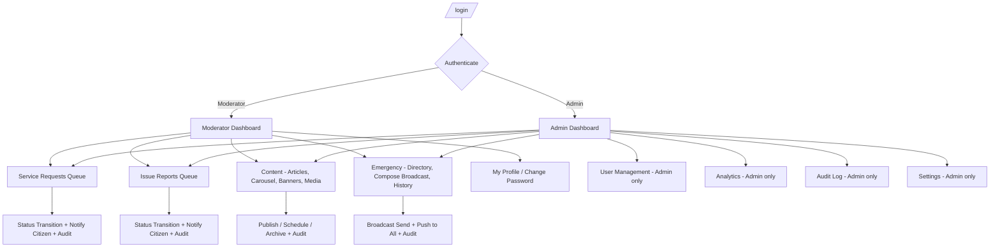

# iGubat — Web Administration Portal Workflow

**Document Type:** Structured Workflow Specification  
**Audience:** AI agents, developers, product managers, designers, ICT Office stakeholders  
**Source TOR:** `igubat_tor.md` v3.1  
**Related:** `igubat_overall_system.md`, `igubat_mobile_app.md`, `igubat_user_stories.md`

---

## 1. Overview

This document describes the end-to-end workflow that LGU staff follow on the iGubat Web Administration Portal, from login through daily operations across the citizen request queue, issue report handling, content management, emergency directory and broadcasts, and (for Admin only) user management, analytics, audit logs, and system settings.

This workflow accommodates two distinct staff roles:

- **Moderator** — LGU operational staff. Processes service requests, handles issue reports, manages content, manages the emergency directory, and sends emergency broadcasts.
- **Admin** — Super administrator. Has all Moderator capabilities plus exclusive access to User Management, Analytics, Audit Logs, and System Settings.

Both Moderator and Admin operate from desktop browsers (Chrome, Firefox, Edge, Safari — current stable versions).

---

## 2. Actors

- **Moderator (LGU Staff)** — assigned by the Admin; sees a queue-centric portal scoped to operations and content.
- **Admin (LGU Super Administrator)** — created during initial deployment; sees the full portal including user management, analytics, audit logs, and settings.
- **Authenticated User (Citizen)** — receives notifications and visible status changes as the result of Moderator/Admin actions (see `igubat_mobile_app.md`).
- **System** — performs background work: audit logging, push notification dispatch, retry on failure, signed URL issuance, cache invalidation, session enforcement.

---

## 3. Entry Point

Staff enter the portal at `/login`. Successful authentication routes the user to the **Dashboard**. The Dashboard layout adapts to role:

- **Moderator dashboard** — pending request queue widget, open issue report widget, draft articles widget, recent broadcasts widget.
- **Admin dashboard** — all Moderator widgets plus a high-level analytics summary, a recent audit-events widget, and shortcuts to User Management.

---

## 4. Step-by-Step Workflow

### Step 1 — Staff Login

- The staff member opens `/login` and enters their staff email and password.
- On submission, the System validates credentials.
- Five consecutive failed attempts trigger **account lockout** logged in the audit trail; the Admin may unlock the account.
- The System enforces session expiration after **30 minutes of inactivity** (default, configurable by Admin).
- All login and logout events are written to the audit log with timestamp and IP address.

**Decision point:**

- If the role is **Moderator** → route to Moderator Dashboard (operations and content surfaces only).
- If the role is **Admin** → route to Admin Dashboard (full portal).

### Step 2 — Service Request Processing (Moderator and Admin)

#### Step 2a — Open the Queue

- The staff member opens **Service Requests** from the sidebar.
- Filters: service type (Facility Use, Medical Assistance, Transportation Assistance), status (Pending, In Review, Approved, Rejected, For Pickup, Completed), barangay, date range.
- Default sort is oldest-first by submission date, surfacing aged work.

#### Step 2b — Open a Request

- The staff member clicks a row to open the detail view.
- The detail shows: requestor name, barangay, contact, description, preferred date/time, attachments (image preview, PDF preview), and full status history.

#### Step 2c — Apply Status Transition

- The staff member selects the next status. Allowed transitions follow the canonical lifecycle:

  `Pending → In Review → Approved | Rejected | For Pickup → Completed`
- The transition action accepts an optional **internal remark** (staff-only) and an optional **citizen-facing remark** (visible to the citizen in the mobile app).
- On save, the System:
  - Persists the new status and remarks.
  - Writes an audit log entry (actor, role, timestamp, action).
  - Triggers a push notification to the citizen.

### Step 3 — Issue and Concern Report Handling (Moderator and Admin)

#### Step 3a — Open the Queue

- The staff member opens **Issue Reports** from the sidebar.
- Choose between **List View** and **Map View**.
- Filters: category (Road Damage, Flooding, Waste Management, Street Lighting, Public Safety, Others), status (Received, In Progress, Resolved, Closed), barangay, date range.

#### Step 3b — Open a Report

- The detail view shows: category, description, attached photos (preview), the GPS pin on a map, the citizen's name/contact, and full status history.

#### Step 3c — Apply Status Transition

- The staff member selects the next status. Allowed transitions:

  `Received → In Progress → Resolved → Closed`
- Public remarks are visible to the citizen. Internal notes are staff-only.
- On save, the System persists the change, audit-logs it, and pushes a notification to the citizen.

#### Step 3d — Admin Map View

- The Admin can toggle a **heatmap** layer and use barangay-based clustering across the entire dataset.
- Filters apply to both list and map.

### Step 4 — Content Management (Moderator and Admin)

#### Step 4a — Articles

- **List** view supports the status filter: **Draft | Published | Archived**.
- **Create / Edit** uses a rich text editor (headings, paragraphs, lists, links, inline images).
- The staff member assigns categories (Community, Events, Procurement, Announcements), tags, and a featured image.
- Save as **Draft**, schedule a future publication (the System publishes automatically at the scheduled time), or publish immediately. A "Notify subscribers" checkbox on publish triggers a push to all opted-in Authenticated Users.
- **Preview** opens a citizen-view rendering before publish.
- **Archive** removes the article from the public feed; the article record remains in the system.

#### Step 4b — Carousel and Banners

- **Carousel Manager** controls the featured stories carousel on the mobile Home — drag-to-reorder, activate/deactivate, add/remove items.
- **Banner Manager** controls homepage banners — upload, reorder, activate/deactivate.

#### Step 4c — Media Library

- Browse, upload, and **soft-delete** media assets (default 30-day retention). Search/filter by name, type, upload date.
- **Admin** may force permanent delete with confirmation.

### Step 5 — Emergency Directory and Broadcasts (Moderator and Admin)

#### Step 5a — COMCEN Hotlines and Directory

- Manage entries with fields: name, category (COMCEN/Hospitals/BFP/PNP/Disaster), address, contact number, hours, status (active/inactive).
- Changes propagate to the mobile app within minutes (cache invalidation respected).

#### Step 5b — Compose Broadcast

- Open the broadcast composer. Enter the message body (with character count).
- Choose immediate send or schedule for a future date and time.
- Send action requires explicit confirmation due to high-fanout impact.
- The System dispatches push to all opted-in citizens (with the Emergency Broadcast category override behavior).
- A delivery summary (recipient count, failures) is shown after dispatch.

#### Step 5c — Broadcast History

- View list of all sent broadcasts: message, sender, timestamp, recipient count, delivery status.
- Filter by date range.

#### Step 5d — Admin-Only Hard Delete

- The Admin alone may permanently delete a directory entry or a broadcast record. Requires confirmation. Logged in audit.

### Step 6 — User and Staff Account Management (Admin Only)

> **Moderator has no access to User Management. The sidebar item is hidden. Direct URL access returns 403.**

#### Step 6a — Citizen Accounts

- **Search** by name, mobile, email, barangay.
- **View** detail: profile fields, account status, login activity history.
- **Verify** a pending account.
- **Deactivate / Reactivate** an account.
- **Permanently Delete** an account with confirmation.
- **Export** the citizen list to CSV (honoring current filters; sensitive fields redacted per LGU policy).

#### Step 6b — Staff Accounts

- **Create Moderator** with name, email, and temporary password. The new Moderator is required to change password on first login.
- **Edit / Deactivate / Reactivate** staff accounts.
- **Reset Password** for any staff account (forces sign-out everywhere).

#### Step 6c — Login Activity

- View login history for any account: timestamp, IP, user agent, success/failure.

### Step 7 — Analytics and Reports (Admin Only)

> **Moderator has no access to Analytics. The sidebar item is hidden. Direct URL access returns 403.**

- The Admin opens **Analytics** to view:
  - Total and daily active users.
  - New registrations over time.
  - Service request volume by type and status.
  - Issue report volume by category and barangay (with map view).
  - Notification delivery statistics.
- Filters: date range, barangay, service type.
- Export reports to PDF or CSV. Large exports may be processed in the background and emailed when ready.

### Step 8 — Audit Logs (Admin Only)

> **Moderator has no access to the Audit Log.**

- The Admin opens **Audit Log**.
- Filters: actor (search), role, action type, date range.
- A detail view opens for any audit entry, showing all metadata captured (actor, role, timestamp, IP, action, related entity).
- **Export to CSV** is available. The export action is itself logged.
- **No update or delete is possible** on audit records by any role, including the Admin.

### Step 9 — System Settings (Admin Only)

> **Moderator has no access to Settings.**

- **Application:** name, logo, color theme, contact details.
- **Service Types &amp; Categories:** add, edit, disable; form-field configuration per type.
- **Report Categories:** maintain the canonical list (Road Damage, Flooding, Waste Management, Street Lighting, Public Safety, Others).
- **Notification Settings:** channel configuration (SMS provider keys, FCM/APNs config, email provider).
- **File Storage Settings:** size limits, retention, allowed MIME types.
- **System Health &amp; Error Logs:** monitoring view with recent errors and basic uptime.

---

## 5. Decision Points Summary

| Decision Point                    | Trigger                           | Possible Outcomes                                                                         |
| --------------------------------- | --------------------------------- | ----------------------------------------------------------------------------------------- |
| Role routing on login             | Login success                     | Moderator → operational portal; Admin → full portal                                       |
| Service request status transition | Moderator/Admin in request detail | Apply next status per canonical lifecycle, with optional remarks; notification dispatched |
| Issue report status transition    | Moderator/Admin in report detail  | Apply next status per canonical lifecycle; notification dispatched                        |
| Article publish path              | Moderator clicks Save             | Draft, Schedule, or Publish (with optional notify-subscribers)                            |
| Broadcast send                    | Moderator clicks Send             | Send immediately or schedule; confirmation modal required                                 |
| Hard delete vs soft delete        | Delete action                     | Soft-delete by default; Admin can force permanent delete with confirmation                |
| User Management access            | Sidebar / URL navigation          | Allowed for Admin; hidden + 403 for Moderator                                             |
| Analytics access                  | Sidebar / URL navigation          | Allowed for Admin; hidden + 403 for Moderator                                             |
| Audit Log access                  | Sidebar / URL navigation          | Allowed for Admin (read-only); hidden + 403 for Moderator                                 |
| Settings access                   | Sidebar / URL navigation          | Allowed for Admin; hidden + 403 for Moderator                                             |

---

## 6. End States

The web portal workflow holds in one of the following steady states:

1. **Moderator Active** — Moderator processes requests, handles reports, manages content and the emergency directory. No access to admin-only surfaces.
2. **Admin Active** — Admin operates the full portal including User Management, Analytics, Audit, and Settings.
3. **Session Expired** — After 30 minutes of inactivity, the staff member is signed out and returned to `/login` (state preserved where possible).
4. **Locked Out** — After 5 consecutive failed logins; recoverable by another Admin or via the unlock procedure.
5. **Deactivated** — Account deactivated by an Admin; no portal access until reactivation.

---

## 7. Key System Behaviors

- **Strict RBAC at UI and API.** Moderator-restricted surfaces (User Management, Analytics, Audit Logs, Settings) are hidden from the sidebar and refused at the API even if the user constructs the URL manually.
- **Canonical lifecycles are enforced server-side.** Status transitions outside the canonical paths are rejected.
- **Notifications fire on every citizen-visible status change.** Push to the citizen + in-app inbox entry + (optional) email.
- **Audit log is append-only.** No role can update or delete entries; Admin can read and export.
- **Soft-delete is the default.** Files and content soft-delete with a 30-day retention; Admin may force permanent delete with confirmation.
- **Session policy.** 30-minute idle timeout for the portal by default, configurable in Settings.
- **Brute-force protection.** Account lockout after 5 failed logins; rate limits on login and password reset endpoints.
- **Signed URLs.** Attachments are served via authenticated, time-limited signed URLs.
- **Emergency broadcasts.** High-priority push; explicit confirmation modal on send; delivery summary captured.
- **Content scheduling.** Scheduled articles transition from Draft to Published at the scheduled time automatically; cancellation returns to Draft.

---

## 8. Permission Matrix

The matrix below is the source-of-truth for portal access. Each cell answers "Can this role perform this action?" Empty cells indicate the role cannot perform the action; a check (✓) indicates the role can.

| Surface / Action                                                 | Moderator | Admin |
| ---------------------------------------------------------------- | --------- | ----- |
| Login to portal                                                  | ✓         | ✓     |
| View Dashboard                                                   | ✓         | ✓     |
| View Service Request queue                                       | ✓         | ✓     |
| Open Service Request detail                                      | ✓         | ✓     |
| Transition Service Request status                                | ✓         | ✓     |
| Add internal remark on Service Request                           | ✓         | ✓     |
| Attach supplementary document                                    | ✓         | ✓     |
| View Issue Report queue (list)                                   | ✓         | ✓     |
| View Issue Report map                                            | ✓         | ✓     |
| Transition Issue Report status                                   | ✓         | ✓     |
| Add public remark / internal note on Report                      | ✓         | ✓     |
| Heatmap of all reports                                           |           | ✓     |
| Article list (Draft/Published/Archived)                          | ✓         | ✓     |
| Create / Edit / Schedule / Publish / Archive article             | ✓         | ✓     |
| Notify subscribers on publish                                    | ✓         | ✓     |
| Permanently delete article                                       |           | ✓     |
| Carousel Manager                                                 | ✓         | ✓     |
| Banner Manager                                                   | ✓         | ✓     |
| Media Library — upload, browse, soft-delete                      | ✓         | ✓     |
| Media Library — permanent delete                                 |           | ✓     |
| COMCEN hotlines: add/edit/deactivate                             | ✓         | ✓     |
| Directory entries: add/edit/deactivate                           | ✓         | ✓     |
| Directory entries: permanent delete                              |           | ✓     |
| Compose broadcast                                                | ✓         | ✓     |
| Schedule broadcast                                               | ✓         | ✓     |
| Send broadcast (with confirmation)                               | ✓         | ✓     |
| View broadcast history                                           | ✓         | ✓     |
| Permanently delete broadcast record                              |           | ✓     |
| **User Management — Citizens (search/view)**                     |           | ✓     |
| **User Management — Citizens (verify/deactivate/delete/export)** |           | ✓     |
| **User Management — Staff (create Moderator)**                   |           | ✓     |
| **User Management — Staff (edit/deactivate/reset password)**     |           | ✓     |
| **View login activity for any account**                          |           | ✓     |
| **Analytics Dashboard**                                          |           | ✓     |
| **Analytics filters and export**                                 |           | ✓     |
| **Audit Log (view, filter, export)**                             |           | ✓     |
| **System Settings — Application/Service/Notification/Storage**   |           | ✓     |
| **System Settings — System Health &amp; Error Logs**             |           | ✓     |
| View own staff profile                                           | ✓         | ✓     |
| Change own password                                              | ✓         | ✓     |

---

## 9. Workflow Diagram

---

*Document version 1.0 — aligned to `igubat_tor.md` v3.1. Roles in scope: Moderator, Admin, System. Related: `igubat_mobile_app.md` for the citizen counterpart.*