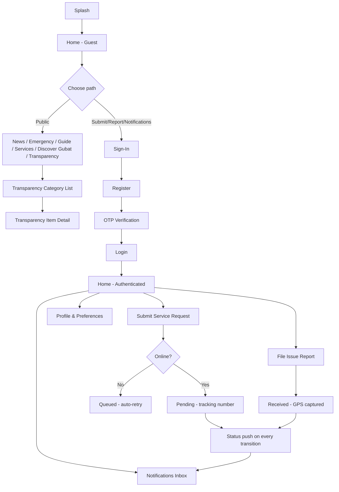

# iGubat — Citizen Mobile App Workflow

**Document Type:** Structured Workflow Specification  
**Audience:** AI agents, developers, product managers, designers, ICT Office stakeholders  
**Source TOR:** `igubat_tor.md` v3.2  
**Related:** `igubat_overall_system.md`, `igubat_admin_portal.md`, `igubat_user_stories.md`

---

## 1. Overview

This document describes the end-to-end workflow that a resident of the Municipality of Gubat, Sorsogon, follows on the citizen mobile application, from first launch through registration, daily authenticated use, public Transparency & Good Governance browsing, and offline/emergency scenarios.

The flow accommodates two distinct user types:

- **Guest** — first-time or unauthenticated visitors who use public surfaces (Home, News, Emergency, Citizen Guide, Services directory) without registering.
- **Authenticated User** — registered, OTP-verified residents with full mobile app access (Service Requests, Issue Reports, Notifications, Profile).

---

## 2. Actors

- **Guest (User)** — any person opening the mobile app without an account.
- **Authenticated User (User)** — a resident with a verified account.
- **Moderator (LGU Staff)** — receives notifications about new submissions and acts on them through the web administration portal (described in `igubat_admin_portal.md`).
- **System** — the iGubat application itself, which routes the user, captures data, sends notifications, persists state, retries on failure, and caches content for offline use.

---

## 3. Entry Point

The citizen enters the workflow at the **Splash screen** on first app launch, which then routes to the **Home** screen. The user is in the Guest role by default.

---

## 4. Step-by-Step Workflow

### Step 1 — Splash and Home

- The app launches into a Splash screen with the iGubat logo, then routes to **Home**.
- The Home screen presents:
  - Time-of-day greeting in Filipino/Visayan (e.g., **"Maayong Buntag, Gubat!"**) for Guests; **"Maayong Buntag, Juan!"** for Authenticated Users.
  - A persistent **notification bell** in the header. For Guests it routes to the Sign-In screen; for Authenticated Users it shows an unread count and opens the in-app inbox.
  - The **quick-action grid** with tiles: Services, Citizen Guide, E-Services, Emergency, Utilities, Transport, Business, Discover Gubat, View More.
  - A **Transparency & Good Governance** section above the news feed, rendered as a 2×3 tile grid for the six disclosure categories with the subtitle **"Know where your taxes go"**.
  - A "Help us improve our city" banner with a sign-in CTA (visible to Guests).

**Decision point:**

- If the user is a Guest and chooses to **register/sign in** → proceed to Step 2 (Auth flow).
- If the user is a Guest and continues with public actions → proceed to Step 3 (Public Browsing).
- If the user is already authenticated → proceed to Step 4 (Authenticated Daily Use).

### Step 2 — Auth Flow (Registration → OTP → Login)

#### Step 2a — Registration

- The Guest taps "Create Account" from the Sign-In screen.
- The Registration form captures: **full name, barangay** (canonical list), complete address, mobile number, optional email, and password (minimum 8 alphanumeric characters).
- The **Privacy Notice** is presented inline; the Guest must check the **DPA consent** checkbox (per Republic Act No. 10173) before submission.
- On submit, the System creates an unverified account and dispatches an **OTP** via SMS to the registered mobile number (or email if mobile is unavailable).
- The Guest is routed to the OTP screen.

#### Step 2b — OTP Verification

- The Guest enters a **6-digit OTP**.
- Invalid or expired OTPs return a clear error.
- Resend is rate-limited (cool-down with countdown).
- A successful verification activates the account and routes to **Login** (or directly to the authenticated Home if implementing a single-step activation).

#### Step 2c — Login

- The Guest enters mobile or email + password.
- The System validates credentials.
- Five consecutive failed attempts trigger **account lockout**, surfaced as a friendly notice with a cool-down period.
- On success, the user is now classified as **Authenticated User** and routes to the authenticated Home.

#### Step 2d — Forgot Password (alternative)

- From Login, the Guest taps "Forgot Password," enters mobile/email, receives a single-use OTP, and sets a new password.
- All existing sessions are invalidated.

**Next state:** Authenticated Home (Step 4)

### Step 3 — Public Browsing (Guest Path)

The Guest can complete the following journeys without authenticating:

- **News:** Open News from the bottom tab or quick action. Browse the **featured carousel** and **Latest News** feed with category filters (Community, Events, Procurement, Announcements). Tap an article for the full view. Search by keyword.
- **Emergency:** Open Emergency from the quick-action grid or persistent shortcut. Use the **"For Emergencies, Call 911"** slide-to-call card. Use one-tap call or copy-to-clipboard on **COMCEN hotlines (Smart, TNT, Landline)**. Tap a category shortcut (Hospitals, BFP, PNP, Disaster Response) to view the corresponding directory.
- **Citizen Guide:** Open static guide pages (cached for offline).
- **Services Directory:** Open Services to read descriptions of available LGU services. Attempting "Submit" routes to the Sign-In screen (Step 2).
- **Discover Gubat:** Open the **Discover Gubat** tile to explore the municipality's identity across three sections — **Tourist Spots** (e.g., Buenavista and Rizal beaches, Castillo de Gubat, San Antonio de Padua Church), **Festivals & Culture** (e.g., the Ginubat Festival, heritage and local traditions), and **Local Delicacies & Products** (e.g., timitim, salanigo, binut-ong, pili nuts) with where-to-buy / pasalubong notes. Tourist spots show photos and a map location; all content is read-only and cached for offline viewing.
- **Transparency & Good Governance:** From the Home section (a 2×3 tile grid above the news feed, subtitle "Know where your taxes go"), open any of six categories of LGU disclosures — **Program and Projects, Bids and Projects, Financial Reports, Annual Budget, Legislative Ordinances, Executive Orders**. Browse published items most-recent first, filter by fiscal year/status, tap an item to read its type-specific metadata and full text, and download attached PDFs via signed URLs. All content is public and cached for offline viewing.

**End state (for Guest):** The Guest can fulfill information needs, explore Gubat's tourism, culture, and local products, and reach emergency services. Submission flows require Step 2.

### Step 4 — Authenticated Daily Use

The Authenticated User has all Guest access, plus the surfaces below.

#### Step 4a — Submit a Service Request

- Open the Services Catalog from Home or the quick-action tile.
- Choose a service type (canonical: **Facility Use, Medical Assistance, Transportation Assistance**).
- Fill in: description, preferred date/time, up to **3 attachments** (JPEG/PNG/GIF/PDF, ≤5 MB each).
- Contact information is auto-populated from the profile.
- Submit. The System:
  - Creates a request in status **Pending**.
  - Generates and displays a **tracking number**.
  - Triggers notifications to Moderators.
- The user lands on the **Request Submission Receipt** with the tracking number and a CTA to view in "My Requests."

#### Step 4b — Track and Cancel Requests

- Open **My Requests** from Profile or the relevant tab.
- View list with status badges and search/filter.
- Open detail to see status history, attachments, and remarks.
- While status is **Pending**, the user may **Cancel** the request. Cancellation is recorded in the status history.
- The user receives **push notifications on every status transition** (`Pending → In Review → Approved | Rejected | For Pickup → Completed`).

#### Step 4c — File an Issue Report

- Open **Report an Issue** from Home.
- Choose a category (canonical: **Road Damage, Flooding, Waste Management, Street Lighting, Public Safety, Others**).
- Enter description and attach up to **3 photos**.
- The System requests **GPS permission** (only for this flow). On grant, the device location is auto-detected on the map. The user may drag the pin to adjust.
- Submit. The System:
  - Creates a report in status **Received**.
  - Triggers notifications to Moderators.
- Track in **My Reports** (status timeline: `Received → In Progress → Resolved → Closed`), with **public remarks** added by the Moderator visible to the citizen.

#### Step 4d — Notifications

- Tap the notification bell to open the in-app inbox.
- View all received notifications, mark as read individually or all at once.
- Deep-link routes carry the user to the relevant detail (article, request, report, transparency item).

#### Step 4e — Profile and Preferences

- View and update **profile fields** (name, address, barangay, contact).
- **Upload/change profile photo**.
- **Change password** (requires current password).
- Manage **notification preferences** per category (News, Service Request status, Issue Report status, Discover Gubat, Transparency, Emergency Broadcasts). Muting Emergency Broadcasts requires a confirmation dialog.
- Toggle **appearance** between Light and Dark mode.
- **Sign out** invalidates the session and returns to the Guest Home.

### Step 5 — Emergency Scenario (Always Available)

- The Emergency surface is reachable from Home for both Guest and Authenticated User at any time, including offline.
- **911 slide-to-call**, **COMCEN hotlines**, and the **directory** function regardless of authentication.
- The latest copy of the directory is cached at first load and remains available offline.

### Step 6 — Offline Scenario

- When connectivity is lost, the app surfaces an **offline notice** banner.
- **Cached content** remains accessible: last 20 news articles, emergency hotlines/directory, citizen guide pages, Discover Gubat content (tourist spots, festival/culture articles, local products), and Transparency items per content type — each with a **"Last updated"** timestamp. Transparency attachment metadata remains visible offline; attachment files require network unless previously opened.
- **Submissions** attempted while offline are queued. The System displays an "Offline — will retry" indicator and **automatically retries** when connectivity returns, preserving the original timestamp where appropriate.
- The user can continue to read cached content and place phone calls via the device dialer.

---

## 5. Decision Points Summary

| Decision Point                          | Trigger                                             | Possible Outcomes                                                                      |
| --------------------------------------- | --------------------------------------------------- | -------------------------------------------------------------------------------------- |
| Guest or Authenticated User on app open | App launch                                          | Continue as Guest (public surfaces) or initiate Auth flow                              |
| Sign-In gating on submit                | Guest taps Submit on a Service or "Report an Issue" | Route to Sign-In; on success, return to the source flow                                |
| OTP success or failure                  | OTP entered                                         | Account activated and routed to Login/Home; or error with resend option (rate-limited) |
| Account lockout                         | 5 consecutive failed logins                         | Lockout notice with cool-down; Admin may unlock                                        |
| Cancel allowed                          | Status check on request detail                      | Cancel control visible only while status is `Pending`                                  |
| GPS permission granted                  | First Issue Report submission                       | Auto-detect location; otherwise user adjusts the pin manually                          |
| Online vs offline                       | Network state at submit                             | Submit immediately or queue and retry on reconnect                                     |

---

## 6. End States

The mobile workflow terminates (or holds) in one of the following states:

1. **Guest Browsing Complete** — the Guest fulfilled public-information needs (News, Emergency, Citizen Guide, Services directory, Discover Gubat, Transparency & Good Governance) without registering.
2. **Authenticated and Active** — the Authenticated User can submit requests, file reports, and receive personalized notifications. Recurring use is the steady state.
3. **Submitted and Awaiting Action** — the citizen has a Service Request in `Pending`/`In Review`/`Approved`/`For Pickup` or an Issue Report in `Received`/`In Progress`, waiting on the Moderator.
4. **Offline with Queued Submission** — the citizen attempted a submission without connectivity; the System will auto-retry on reconnect.
5. **Locked or Deactivated** — the account is temporarily locked (failed logins) or deactivated (by Admin), preventing authenticated actions until reset/reactivation.

---

## 7. Key System Behaviors

- **No authentication required for public surfaces.** Home (public), News, Emergency, Citizen Guide, the Services directory, Discover Gubat (tourism, culture, local products), and Transparency & Good Governance disclosures are always available to Guests.
- **Auth gating is contextual.** The Sign-In prompt is shown only at the moment a Guest attempts an authenticated action (submit/report/notifications), so public information is never blocked behind a wall.
- **Privacy and consent at registration.** Privacy Notice display and explicit DPA consent are required before account creation.
- **OTP for verification and password reset.** SMS (default) or email; rate-limited resend; single-use, time-bound codes.
- **Account lockout.** Triggered after 5 consecutive failed logins; logged and recoverable by Admin.
- **Status notifications.** Push (FCM/APNs) + in-app inbox entries fire on every status change of the citizen's request or report.
- **Emergency broadcasts.** High-priority push delivered to all Authenticated Users; by default they bypass quiet hours and category mute, with an explicit citizen opt-out flow that requires confirmation.
- **GPS only on report flow.** Location permission is requested only when needed, not on app start.
- **Attachment validation.** All uploads validated for MIME and size (JPEG/PNG/GIF/PDF, ≤5 MB, max 3 per submission); scanned for malicious content; auto-compressed.
- **Offline support.** Caches last 20 articles, emergency directory, citizen guide, Discover Gubat, and Transparency items (per type); queues submissions; auto-retries; surfaces "Last updated" timestamps.
- **Transparency disclosures are public.** The six Transparency categories are read-only and require no authentication; attachments are served via time-limited signed URLs. The new `transparency` notification category (Step 4d) is opt-in for Authenticated Users and deep-links a tapped push to the item detail.
- **Bilingual greetings.** Time-of-day greetings use Filipino/Visayan phrases relevant to Gubat.
- **Appearance.** Light and Dark themes; user-controlled.
- **Session expiry.** Mobile sessions expire after a configurable idle period (default 7 days).
- **Tamper-evident audit.** Significant actions (registration, login, submission, status changes received) are reflected in the centralized audit log on the server side (see `igubat_admin_portal.md`).

---

## 8. Mobile Workflow Diagram

---

*Document version 1.0 — aligned to `igubat_tor.md` v3.2. Roles in scope: Guest, Authenticated User, System. Related: `igubat_admin_portal.md` for the staff counterpart.*
