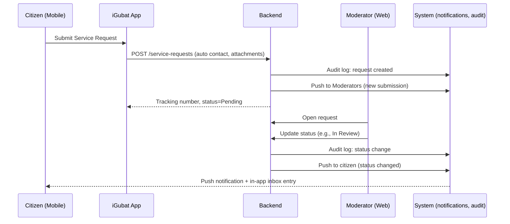

# iGubat — Overall System Structure

**Document Type:** Structured Workflow Specification  
**Audience:** AI agents, developers, product managers, designers, ICT Office stakeholders  
**Source TOR:** `igubat_tor.md` v3.2

---

## 1. Overview

This document describes the complete navigation structure and routing logic of the iGubat LGU Digital Services Application across both platforms — the **Citizen Mobile Application** and the **Web Administration Portal**. It enumerates every entry point a Guest, Authenticated User, Moderator, or Admin can reach, including the public Discover Gubat and Transparency & Good Governance surfaces, identifies which surfaces are in the **MVP (Phase 1 + 2)** and which are deferred to later phases, and cross-references the per-module deep-dive workflow documents.

Two clusters are designated **Focused Development**:

1. **Citizen Onboarding and Public Access** — Authentication, Citizen Profile, Home and Navigation, News and Announcements, Emergency Hotline and Directory, Discover Gubat, and Transparency & Good Governance.
2. **LGU Service Operations** — Service Requests, Issue and Concern Reports, Notification System.

---

## 2. Actors

The system supports exactly four canonical roles. Each role lives on exactly one platform.


| Role                   | Platform                     | Access Summary                                                                                            |
| ---------------------- | ---------------------------- | --------------------------------------------------------------------------------------------------------- |
| **Guest**              | Mobile App (unauthenticated) | Public content: Home, News, Emergency, Citizen Guide, Services directory (read-only)                      |
| **Authenticated User** | Mobile App (signed in)       | All Guest access + Profile, Service Requests, Issue Reports, in-app Notifications                         |
| **Moderator**          | Web Administration Portal    | Service Request queue, Issue Report queue and map, Content Management, Emergency Directory and Broadcasts |
| **Admin**              | Web Administration Portal    | All Moderator access + User Management, Analytics, Audit Logs, System Settings                            |


The role **System** is referenced in workflows where the application itself acts (automated notifications, retries, audit logging).

---

## 3. Entry Points


| Platform   | Entry Point               | Roles                                   |
| ---------- | ------------------------- | --------------------------------------- |
| Mobile App | Home (after splash)       | Guest, Authenticated User               |
| Mobile App | Sign-In screen            | Authenticated User (post-auth re-entry) |
| Web Portal | `/login`                  | Moderator, Admin                        |
| Web Portal | `/dashboard` (post-login) | Moderator, Admin                        |


---

## 4. Mobile Application Navigation Tree

```
Mobile App (iOS / Android)
├── Splash
├── Home  (Guest | Authenticated User)
│   ├── Greeting Banner (time-of-day, personalized when signed in)
│   ├── Notification Bell  ──► (Guest: Sign-In) | (Auth: Notification Inbox)
│   ├── Quick-Action Grid
│   │   ├── Services           ──► Services Directory
│   │   ├── Citizen Guide      ──► Guide Pages (cached)
│   │   ├── E-Services         ──► Service Catalog
│   │   ├── Emergency          ──► Emergency Screen
│   │   ├── Utilities          ──► Directory: Utilities
│   │   ├── Transport          ──► Directory: Transport
│   │   ├── Business           ──► Directory: Business
│   │   ├── Discover Gubat      ──► Discover Gubat Home
│   │   └── View More          ──► Full Directory
│   └── "Help us improve our city" Banner ──► Sign-In CTA
│
├── News  (Guest | Authenticated User)
│   ├── Featured Stories Carousel
│   ├── Latest News Feed (filter by category)
│   ├── Search
│   └── Article Detail
│
├── Emergency  (Guest | Authenticated User)
│   ├── 911 Slide-to-Call Card
│   ├── COMCEN Hotlines (Smart, TNT, Landline)
│   │   ├── Tap-to-call
│   │   └── Copy-to-clipboard
│   ├── Category Shortcuts
│   │   ├── Hospitals
│   │   ├── Fire Protection (BFP)
│   │   ├── Police (PNP)
│   │   └── Disaster Response
│   └── Directory Detail (name, address, contact, hours)
│
├── Transparency & Good Governance  (Guest | Authenticated User)
│   ├── Program and Projects ──► Category List ──► Item Detail (metadata band, attachments)
│   ├── Bids and Projects
│   ├── Financial Reports
│   ├── Annual Budget
│   ├── Legislative Ordinances
│   └── Executive Orders
│
├── Discover Gubat  (Guest | Authenticated User)
│   ├── Tourist Spots (Beaches & Surfing, Nature & Eco-Tourism, Heritage & Landmarks)
│   │   └── Tourist Spot Detail (photos, description, map location)
│   ├── Festivals & Culture
│   │   └── Culture/Festival Article Detail
│   └── Local Delicacies & Products (Delicacies/Kakanin, Pasalubong, Handicrafts/OTOP, Seafood, Pili)
│       └── Local Product Detail (photo, description, where-to-buy)
│
├── Services Catalog  (Guest [view] | Authenticated User [submit])
│   ├── Facility Use
│   ├── Medical Assistance
│   └── Transportation Assistance
│       └── Submit Request Flow (Auth required)
│
├── My Requests  (Authenticated User)
│   ├── List with status badges
│   └── Request Detail (status history, attachments)
│
├── Report an Issue  (Authenticated User)
│   ├── Submit Report Flow (category, description, photos, GPS)
│   ├── My Reports List
│   └── Report Detail (status timeline, public remarks)
│
├── Notifications  (Authenticated User)
│   ├── Inbox (all received)
│   ├── Mark Read / Mark All Read
│   └── Deep Link Routes
│
├── Profile  (Authenticated User)
│   ├── View / Edit Profile
│   ├── Change Password
│   ├── Notification Preferences
│   ├── Appearance (Light / Dark)
│   └── Sign Out
│
└── Auth Flow
    ├── Register (with Privacy Notice + Consent)
    ├── OTP Verification (SMS / Email)
    ├── Login
    └── Forgot Password (OTP-driven)
```

---

## 5. Web Administration Portal Navigation / Sidebar

The portal uses a persistent left sidebar. Items are role-gated. Moderator-only and Admin-only items are visually distinguished and protected at both UI and API layers.

```
Web Administration Portal
├── Dashboard            (Moderator | Admin)
│
├── Service Requests     (Moderator | Admin)
│   ├── Queue (filters: type, status, barangay, date)
│   ├── Request Detail
│   └── Status Transition + Internal Remarks
│
├── Issue Reports        (Moderator | Admin)
│   ├── Queue (list view)
│   ├── Map View (filters: category, status, barangay)
│   └── Report Detail
│
├── Content              (Moderator | Admin)
│   ├── Articles
│   │   ├── List (filter: Draft | Published | Archived)
│   │   ├── Create / Edit (rich editor, scheduling, preview)
│   │   └── Publish / Archive
│   ├── Carousel Manager
│   ├── Banner Manager
│   └── Media Library (soft-delete default)
│
├── Emergency            (Moderator | Admin)
│   ├── COMCEN Hotlines
│   ├── Directory (Hospitals, BFP, PNP)
│   ├── Compose Broadcast
│   ├── Scheduled Broadcasts
│   └── Broadcast History
│
├── Transparency       (Moderator | Admin)
│   ├── Item List (type/status/fiscal-year filters, search, Export CSV — Admin)
│   └── Item Editor (type selector, type-specific fields, attachments, publish/schedule/archive, permanent-delete — Admin)
│
├── Discover Gubat       (Moderator | Admin)
│   ├── Tourist Spots (create/edit/publish/archive, photos, map location)
│   ├── Festivals & Culture (article authoring, scheduling, preview)
│   └── Local Delicacies & Products (create/edit/publish/archive, where-to-buy)
│
├── Users                (Admin only)        ◄── HIDDEN FOR MODERATOR
│   ├── Citizens (search, verify, deactivate, delete, export CSV)
│   ├── Staff (create Moderator, edit, deactivate, reset password)
│   └── Login Activity
│
├── Analytics            (Admin only)        ◄── HIDDEN FOR MODERATOR
│   ├── DAU/MAU
│   ├── Registrations Over Time
│   ├── Service Request Volume
│   ├── Reports by Category / Barangay
│   ├── Notification Delivery Stats
│   └── Export (PDF / CSV)
│
├── Audit Log            (Admin only)        ◄── HIDDEN FOR MODERATOR
│   ├── Search & Filter (actor, role, action, date)
│   ├── Detail View
│   └── Export CSV
│
├── Settings             (Admin only)        ◄── HIDDEN FOR MODERATOR
│   ├── Application (name, logo, theme, contact)
│   ├── Service Types & Categories
│   ├── Report Categories
│   ├── Notification Settings
│   ├── File Storage Settings
│   └── System Health & Error Logs
│
└── My Profile           (Moderator | Admin)
    ├── View Profile (read-only personal data)
    └── Change Password
```

---

## 6. Screen-by-Screen Breakdown

### 6.1 Mobile App Screens


| #    | Screen                     | Roles              | Module | Phase | Key Elements                                                                                 |
| ---- | -------------------------- | ------------------ | ------ | ----- | -------------------------------------------------------------------------------------------- |
| M-01 | Splash                     | All                | —      | 1     | Logo, version, route decision                                                                |
| M-02 | Home (Guest)               | Guest              | 3      | 1     | Time-of-day greeting, quick-action grid, "Help us improve" banner, notification bell→sign-in |
| M-03 | Home (Authenticated)       | Authenticated User | 3      | 1     | Personalized greeting, unread badge on bell, quick-action grid                               |
| M-04 | Register                   | Guest              | 1      | 1     | Form fields, Privacy Notice, consent checkbox                                                |
| M-05 | OTP Verification           | Guest              | 1      | 1     | 6-digit code input, resend with countdown                                                    |
| M-06 | Login                      | Guest              | 1      | 1     | Mobile/email + password, Forgot Password link                                                |
| M-07 | Forgot Password            | Guest              | 1      | 1     | Identifier input, OTP, new password                                                          |
| M-08 | News List                  | Guest, Auth        | 4      | 1     | Carousel + Latest feed + search + categories                                                 |
| M-09 | Article Detail             | Guest, Auth        | 4      | 1     | Title, body, images, date, share                                                             |
| M-10 | Emergency Screen           | Guest, Auth        | 7      | 1     | 911 slide-to-call, COMCEN hotlines, category shortcuts                                       |
| M-11 | Directory List (category)  | Guest, Auth        | 7      | 1     | Entries with tap-to-call                                                                     |
| M-12 | Citizen Guide              | Guest, Auth        | 3      | 1     | Cached static pages                                                                          |
| M-13 | Services Catalog           | Guest, Auth        | 5      | 2     | Service tiles by category                                                                    |
| M-14 | Service Request Form       | Auth               | 5      | 2     | Type, description, date/time, attachments                                                    |
| M-15 | Request Submission Receipt | Auth               | 5      | 2     | Tracking number, status                                                                      |
| M-16 | My Requests List           | Auth               | 5      | 2     | Status badges, filter                                                                        |
| M-17 | Request Detail             | Auth               | 5      | 2     | Status timeline, attachments, cancel (if Pending)                                            |
| M-18 | Issue Report Form          | Auth               | 6      | 2     | Category, description, photos, GPS+map pin                                                   |
| M-19 | My Reports List            | Auth               | 6      | 2     | Status badges, filter                                                                        |
| M-20 | Report Detail              | Auth               | 6      | 2     | Status timeline, public remarks                                                              |
| M-21 | Notification Inbox         | Auth               | 8      | 1/2   | Read state, deep links, mark-all-read                                                        |
| M-22 | Profile                    | Auth               | 2      | 1     | View/edit fields, avatar, sign out                                                           |
| M-23 | Change Password            | Auth               | 2      | 1     | Current + new password                                                                       |
| M-24 | Notification Preferences   | Auth               | 2      | 1/2   | Per-category toggles                                                                         |
| M-25 | Appearance                 | Auth               | 2      | 1     | Light / Dark toggle                                                                          |
| M-26 | Offline Notice             | All                | 13     | 1     | Banner + queued submission state                                                             |
| M-27 | Discover Gubat Home        | Guest, Auth        | 12     | 1     | Tourist Spots / Festivals & Culture / Local Delicacies & Products sections                   |
| M-28 | Tourist Spot Detail        | Guest, Auth        | 12     | 1     | Photos, description, category, map location                                                  |
| M-29 | Festival/Culture Detail    | Guest, Auth        | 12     | 1     | Title, body, images, date                                                                    |
| M-30 | Local Product Detail       | Guest, Auth        | 12     | 1     | Photo, description, category, where-to-buy / pasalubong note                                 |
| M-31 | Transparency Section (Home) | Guest, Auth       | 13     | 1     | 2×3 tile grid of six content types; subtitle "Know where your taxes go"                      |
| M-32 | Transparency Category List | Guest, Auth        | 13     | 1     | Published items most-recent first; fiscal-year/status filters; search; cache banner          |
| M-33 | Transparency Item Detail   | Guest, Auth        | 13     | 1     | Type-specific metadata band, summary, body, attachments via signed URL                       |


### 6.2 Web Administration Portal Screens


| #    | Screen                 | Roles      | Module | Phase | Key Elements                                                                       |
| ---- | ---------------------- | ---------- | ------ | ----- | ---------------------------------------------------------------------------------- |
| W-01 | Login                  | Mod, Admin | 1      | 1     | Email + password, lockout messaging                                                |
| W-02 | Dashboard              | Mod, Admin | —      | 1/2   | Role-appropriate widgets: pending queues, recent activity, (Admin) summary metrics |
| W-03 | Service Request Queue  | Mod, Admin | 5      | 2     | Filters, sort, bulk action                                                         |
| W-04 | Service Request Detail | Mod, Admin | 5      | 2     | Citizen info, attachments, status transition, internal remarks                     |
| W-05 | Issue Report Queue     | Mod, Admin | 6      | 2     | List view, filters                                                                 |
| W-06 | Issue Report Map       | Mod, Admin | 6      | 2     | Map pins, filters, (Admin) heatmap toggle                                          |
| W-07 | Issue Report Detail    | Mod, Admin | 6      | 2     | Photos, map, status transition, public + internal remarks                          |
| W-08 | Articles List          | Mod, Admin | 4      | 1     | Filter Draft/Published/Archived                                                    |
| W-09 | Article Editor         | Mod, Admin | 4      | 1     | Rich text editor, scheduling, preview                                              |
| W-10 | Carousel Manager       | Mod, Admin | 4      | 1     | Drag-and-drop, activate toggle                                                     |
| W-11 | Banner Manager         | Mod, Admin | 4      | 1     | Upload, reorder, activate                                                          |
| W-12 | Media Library          | Mod, Admin | 4/11   | 1     | Browse, upload, soft-delete                                                        |
| W-13 | COMCEN Hotlines        | Mod, Admin | 7      | 1     | List, add/edit/deactivate                                                          |
| W-14 | Directory Manager      | Mod, Admin | 7      | 1     | Hospitals/BFP/PNP entries                                                          |
| W-15 | Compose Broadcast      | Mod, Admin | 7/8    | 2     | Message, schedule, confirm send                                                    |
| W-16 | Broadcast History      | Mod, Admin | 7/8    | 2     | Message, sender, timestamp, recipients                                             |
| W-17 | Citizens List          | Admin      | 9      | 3     | Search, filter, CSV export                                                         |
| W-18 | Citizen Detail         | Admin      | 9      | 3     | Status actions, login activity                                                     |
| W-19 | Staff List             | Admin      | 9      | 3     | Create Moderator, edit, deactivate                                                 |
| W-20 | Staff Detail           | Admin      | 9      | 3     | Reset password, role assignment                                                    |
| W-21 | Analytics Dashboard    | Admin      | 10     | 4     | Charts, filters, exports                                                           |
| W-22 | Audit Log              | Admin      | 11     | 3     | Filters, detail, CSV export                                                        |
| W-23 | Settings               | Admin      | —      | 4     | Application/service/notification/file storage settings, system health              |
| W-24 | My Profile (Staff)     | Mod, Admin | 9      | 1     | View profile, change password                                                      |
| W-25 | Discover Gubat Manager | Mod, Admin | 12     | 1     | Tourist spots, festival/culture articles, local products; Draft/Published/Archived; map location, photos |
| W-26 | Transparency Manager List | Mod, Admin | 13   | 1     | Type/status/fiscal-year filters, search; Export CSV (Admin); New Item; archive/permanent-delete |
| W-27 | Transparency Item Editor | Mod, Admin | 13    | 1     | Type selector, type-specific fields, attachments, publish controls (Save Draft/Schedule/Publish + notify) |


---

## 7. MVP vs Phase 2 Scope

### 7.1 MVP (Phase 1 + 2) — In Scope at Initial Launch

**Mobile App:**

- M-01 through M-21, M-22, M-23, M-24, M-25, M-26, M-27–M-30 (Discover Gubat), and M-31–M-33 (Transparency & Good Governance).

**Web Administration Portal:**

- W-01, W-02 (role-appropriate widgets), W-03–W-07 (service requests and issue reports), W-08–W-12 (content + media), W-13–W-16 (emergency directory and broadcasts), W-24 (staff profile), W-25 (Discover Gubat manager), W-26–W-27 (Transparency manager + editor).

**Modules live at MVP:**

- Authentication, Citizen Profile, Home/Navigation, News, Service Requests, Issue Reports, Emergency, Notifications, Tourism/Culture/Local Products (Discover Gubat), Transparency & Good Governance, basic File/Media, Geolocation, Offline Cache.

### 7.2 Phase 3 — Administration and Oversight

- Web: W-17, W-18, W-19, W-20 (User and Staff Management), W-22 (Audit Log).
- Modules: User and Staff Account Management, Audit and Activity Logging.

### 7.3 Phase 4 — Analytics and System Maturity

- Web: W-21 (Analytics Dashboard), W-23 (Settings, including system health).
- Modules: Analytics and Reports; System Settings hardening.

### 7.4 Out of Scope (deferred)

- Online payments, civil registration integration, RPT computation.
- Multi-language UI beyond bilingual greetings/labels.
- Field-officer companion mobile app.
- Public-facing API for third parties.
- Two-Factor Authentication (TOTP) for citizens.

---

## 8. Cross-Platform Behavior Summary



---

## 9. Cross-References


| Topic                              | Reference                    |
| ---------------------------------- | ---------------------------- |
| Functional requirements per module | `igubat_tor.md` §7           |
| Citizen mobile journey details     | `igubat_mobile_app.md`       |
| LGU staff portal journey details   | `igubat_admin_portal.md`     |
| Per-role acceptance criteria       | `igubat_user_stories.md`     |
| Manual test cases                  | `igubat_manual_test_plan.md` |


---

*Document version 1.0 — aligned to `igubat_tor.md` v3.2. Canonical roles: Guest, Authenticated User, Moderator, Admin.*
