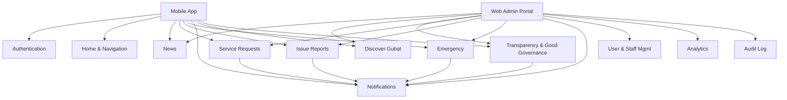

# iGubat — LGU Digital Services Application

## Project Proposal

> **Prepared for:** Municipality of Gubat, Province of Sorsogon (Bicol Region), Information and Communications Technology Office  
> **Prepared by:** Development Team  
> **Source TOR:** `igubat_tor.md` v3.2  
> **Workflow Documents:** `igubat_overall_system.md`, `igubat_mobile_app.md`, `igubat_admin_portal.md`

---

## 1. Executive Summary

This proposal outlines the full design, development, and deployment of the **iGubat Application** — the digital services platform of the Municipality of Gubat, Province of Sorsogon (the product name *iGubat* combines *i* with *Gubat*). The platform modernizes the delivery of LGU services to constituents by giving every resident a single, convenient mobile entry point and giving LGU staff a unified web portal for daily operations.

Based on the four-role model (Guest, Authenticated User, Moderator, Admin) and the thirteen (13) functional modules defined in `igubat_tor.md` — including **Module 13 — Transparency and Good Governance** (public disclosure of programs/projects, procurement bids, financial reports, annual budget, legislative ordinances, and executive orders per the DILG Full Disclosure Policy) — we propose to deliver the complete platform in **four phased tracks**. The sequence is deliberately ordered so that the public-information and emergency surfaces ship first (Phase 1) — giving the LGU value on day one — and the operational, administrative, and analytics layers follow.

The platform consists of two interconnected experiences sharing one backend, one database, and one notification fabric:

- **Citizen Mobile Application (iOS and Android)** — public information, registration, service requests, issue reports, emergency hotlines.
- **Web Administration Portal (desktop)** — queue processing, content management, emergency broadcasts, user management, analytics, audit, settings.

Two clusters are designated **Focused Development** because they unlock immediate civic value:

1. **Citizen Onboarding and Public Access** — the registration funnel, news/announcements, and the always-on emergency surface.
2. **LGU Service Operations** — service request and issue report processing with notifications.

Our delivery centers on these and builds outward.

---

## 2. Platform Understanding

| Field          | Details                                                   |
| -------------- | --------------------------------------------------------- |
| **Platform**   | iGubat — LGU Digital Services Application                 |
| **Domain**     | Local Government Unit (LGU) digital services, Philippines |
| **Geography**  | Municipality of Gubat, Province of Sorsogon (Bicol Region) — coastal town on the Pacific, 42 barangays |
| **Compliance** | Data Privacy Act of 2012 (RA 10173); DILG Full Disclosure Policy / FDPP; RA 9184 procurement disclosures; RA 7160 local budget, ordinances, and executive orders; RA 11032 citizen access to records |

**Local Context (Gubat, Sorsogon).** Gubat is a coastal municipality promoted as **"The Surfing Capital of Sorsogon"** — its Buenavista and Rizal beaches draw beginner and experienced surfers, alongside attractions such as the Dulangan-Nasipit estuary (bioluminescence). Its cultural identity centers on the **Ginubat Festival** (June, town fiesta of San Antonio de Padua) and heritage landmarks like the **San Antonio de Padua Parish Church (1778)** and the **Castillo de Gubat** watchtower. The town is known for its own delicacies and products — **timitim** (cassava-and-pili cake), **salanigo** (hand-woven abaca slippers, an OTOP product), **binut-ong**, **dalu-dalo**, **sikad-sikad**, and **pili nuts** — in addition to the broader Bicol/Sorsogon table (laing, Bicol Express, kinunot). The platform showcases this identity through a dedicated **"Discover Gubat"** surface (Module 12).

**User Types (canonical, four total):**

- **Guest** — anonymous resident or visitor browsing the public mobile app surface (news, hotlines, directory, citizen guide).
- **Authenticated User** — a registered, OTP-verified resident with full mobile app access (request submission, report filing, personalized notifications).
- **Moderator** — LGU operational staff working from the web administration portal: processes service requests, handles issue reports, manages content, manages the emergency directory and broadcasts.
- **Admin** — the highest-level administrator with full portal access: user management, analytics, audit, system settings, plus everything a Moderator can do.

**Service Types (canonical):** Facility Use, Medical Assistance, Transportation Assistance.

**Report Categories (canonical):** Road Damage, Flooding, Waste Management, Street Lighting, Public Safety, Others.

**Status Lifecycles (canonical):**

- Service request: `Pending → In Review → Approved | Rejected | For Pickup → Completed`
- Issue report: `Received → In Progress → Resolved → Closed`
- Article: `Draft | Published | Archived`

---

## 3. Workflow Analysis

### 3.1 Mobile App Workflow (Citizen-Facing)

The citizen journey begins at the **Home** screen with a time-of-day greeting and a quick-action grid. From Home, a Guest can immediately reach **News**, **Emergency**, the **Citizen Guide**, and the **Services** directory. If the citizen taps a feature that requires authentication (Submit Service Request, File Issue Report, Notifications), the system surfaces a sign-in prompt and routes through **Registration → OTP Verification → Login** before completing the action.

Once authenticated, the same Home surfaces personalize: a name-bearing greeting replaces the generic banner, the notification bell shows the unread count, and the same quick-action tiles now launch fully into the request/report flows. The Authenticated User can submit Facility Use, Medical Assistance, or Transportation Assistance requests; can file issue reports of one of six categories with GPS-tagged photos; and receives push notifications on every status change.

The Emergency surface is intentionally accessible without authentication: 911 slide-to-call, COMCEN hotlines (Smart, TNT, Landline), and category shortcuts (Hospitals, BFP, PNP, Disaster Response) are one tap away from Home for both Guest and Authenticated User. Critical content remains available offline via the cache.

### 3.2 Web Administration Portal Workflow (Staff-Facing)

LGU staff log in to the web administration portal with credentials issued by the Admin. Upon login, the staff member is routed to the **Dashboard** with role-appropriate widgets. Moderators land on a queue-centric view (pending service requests, open issue reports, unscheduled broadcasts, draft articles). The Admin lands on a broader view that adds analytics summary cards, recent audit events, and user-management shortcuts.

Service request and issue report processing follow the canonical lifecycles. The Moderator opens an item, reviews citizen-submitted details and attachments, applies a status transition, captures internal remarks, and the system fires push, in-app, and (optionally) email notifications to the citizen.

Content management (news, announcements, carousel, banners) and emergency directory management (COMCEN hotlines, hospital/BFP/PNP entries, broadcast alerts) are also operated by the Moderator. The Admin alone reaches **User Management**, **Analytics and Reports**, **Audit Logs**, and **System Settings**.

### 3.3 Module Map

---

## 4. Proposed Build Scope

### Track 1 — Citizen Onboarding and Public Access *(Focused Development)*

**Authentication Module**

- Self-registration via mobile (full name, barangay, address, mobile, password) with explicit DPA consent.
- OTP verification via SMS or email.
- Login, logout, password reset (OTP-driven).
- Session management with configurable idle expiration.
- Account lockout after 5 failed attempts.

**Citizen Profile Module**

- View and edit profile (name, address, barangay, contact).
- Upload/change profile photo.
- Notification preferences per type.
- Appearance preference (light/dark).

**Home and Navigation Module**

- Time-of-day greeting (Filipino/Visayan salutations).
- Quick-action grid (Services, Citizen Guide, E-Services, Emergency, Utilities, Transport, Business, Discover Gubat, View More).
- Personalized greeting and notification badge for Authenticated User.

**News and Announcements Module**

- Public article list, featured stories carousel, category filtering, keyword search.
- Authenticated push on new article publication.
- Full article view with images and publication metadata.

**Emergency Hotline and Directory Module**

- 911 slide-to-call card.
- COMCEN hotlines (Smart, TNT, Landline) with one-tap call and copy-to-clipboard.
- Category shortcuts (Hospitals, BFP, PNP, Disaster Response).
- Directory entries with name, address, contact number, hours.

**Tourism, Culture &amp; Local Products Module ("Discover Gubat")**

- Public "Discover Gubat" surface with three sections: **Tourist Spots**, **Festivals &amp; Culture**, and **Local Delicacies &amp; Products**.
- Tourist spots with photos, descriptions, category (Beaches &amp; Surfing, Nature &amp; Eco-Tourism, Heritage &amp; Landmarks), and map location.
- Festival/culture articles (e.g., Ginubat Festival, heritage church and watchtower, local dialect and traditions).
- Local delicacy/product directory (e.g., timitim, salanigo, binut-ong, pili nuts) with where-to-buy / pasalubong notes.
- Moderator authoring with the canonical **Draft | Published | Archived** lifecycle; offline-cached for citizens; read-only/informational in v1.

**Transparency and Good Governance Module (Module 13)**

- Public mobile section ("Know where your taxes go") above the news feed with six content types: **Program and Projects, Bids and Projects, Financial Reports, Annual Budget, Legislative Ordinances, Executive Orders** — fulfilling the DILG Full Disclosure Policy and RA 9184 / RA 7160 / RA 11032.
- Read-only for Guest and Authenticated User: browse by category (most-recent first), filter by fiscal year/status, open item detail with type-specific metadata, download attachments via signed URL; offline-cached.
- Web CMS for Moderators using the canonical **Draft → Scheduled → Published → Archived** lifecycle (type selector, type-specific fields, attachments, schedule, notify-subscribers); Admin-only permanent delete and CSV export.

**Cross-Cutting**

- File and Media Management foundational scope (image upload, signed URLs, virus scan).
- Connectivity and Offline Support (cache last 20 articles, hotlines, citizen guide, Discover Gubat content, and Transparency items).

---

### Track 2 — LGU Service Operations *(Focused Development)*

**Service Request Module**

- Submission flow: type, description, preferred date/time, up to 3 attachments, auto-populated contact info.
- Tracking number generation.
- Status lifecycle: `Pending → In Review → Approved | Rejected | For Pickup → Completed`.
- Citizen-side cancel while in `Pending`.
- Moderator queue with filters (service type, status, barangay, date).
- Internal remarks (staff-only) and supplementary document attachment.

**Issue and Concern Reports Module**

- Submission with category, description, up to 3 photos, GPS auto-detect + manual pin adjustment.
- Status lifecycle: `Received → In Progress → Resolved → Closed`.
- Moderator queue with list view and map view.
- Admin-level interactive map and heatmap with category/status/barangay filters.

**Notification Module**

- Push (FCM/APNs), in-app inbox, transactional email.
- Per-event automated triggers (status changes, new submissions to Moderators).
- Per-user preferences honored.
- Emergency broadcast delivery to all registered citizens.

**Geolocation and Mapping**

- GPS capture from the mobile app.
- Map display and pin adjustment.
- Server-side map rendering of reports and clustering by barangay.

---

### Track 3 — Administration and Oversight

**User and Staff Account Management Module**

- Admin creates Moderator accounts (name, email, temporary password).
- Admin edits, deactivates, reactivates, and resets passwords for any staff or citizen account.
- Citizen account search, verification, deactivation, deletion, CSV export.
- Login activity history per account.

**Audit and Activity Logging Module**

- Automated logging of significant events (logins, status changes, content actions, broadcasts, settings changes).
- Admin-only audit log viewer with filters and CSV export.
- Append-only, tamper-evident storage.

**Web Portal Hardening**

- Strict RBAC: Moderator cannot reach Analytics, Settings, Audit, or User Management surfaces.
- Session timeout, IP logging, brute-force protection on the admin portal.

---

### Track 4 — Analytics and System Maturity

**Analytics and Reports Module**

- Dashboard widgets: DAU/MAU, registrations over time, service request volume by type/status, reports by category/barangay, top issues, notification delivery stats.
- Filters: date range, barangay, service type.
- PDF/CSV export.

**System Settings**

- Application name, logo, color theme, contact details.
- Manageable lists: service types, report categories, request form fields.
- Notification settings, file storage settings.
- System health and error logs view.

**Performance and Operations**

- Load testing toward the 500-concurrent-user NFR.
- Backup verification and disaster-recovery drill.
- Operational handover and runbooks.

---

## 5. Recommended Delivery Sequence

**Phase 1 — Citizen Foundation and Public Access**

- Authentication, Citizen Profile, Home and Navigation, News and Announcements, Emergency Hotline and Directory.
- Tourism, Culture &amp; Local Products ("Discover Gubat").
- Transparency and Good Governance (Module 13) — public read-only disclosures.
- Foundational Notification System (transactional email, OTP delivery).
- Offline cache for news, hotlines, citizen guide, Discover Gubat, and Transparency content.
- Initial deployment, environments, app store enrollment.

> **Outcome:** Residents can install the iGubat app and immediately access official news, the citizen guide, emergency hotlines, the Discover Gubat tourism/culture/products surface, and the Transparency & Good Governance disclosures — seeing what the LGU is doing, what it is buying, how it spends, and what it has enacted, fulfilling the Full Disclosure Policy. The LGU can publish content. The registration funnel is open even before request/report features ship.

**Phase 2 — Service Operations**

- Service Requests, Issue Reports, full Notification System, Geolocation and Mapping.
- Moderator queues, map view, push notifications on status changes.

> **Outcome:** Residents can submit requests and reports; LGU staff can process them end-to-end with real-time push notifications back to citizens.

**Phase 3 — Administration and Oversight**

- User and Staff Account Management, Audit and Activity Logging.
- Web portal hardening, RBAC enforcement, session controls.

> **Outcome:** The Admin has full lifecycle control over accounts and the LGU has an immutable accountability trail.

**Phase 4 — Analytics and System Maturity**

- Analytics and Reports, System Settings, performance tuning, training, handover.

> **Outcome:** Data-driven oversight; configuration owned by the LGU; the platform is operational and self-managed.

---

## 6. Investment Breakdown

### 6.1 Phase-Based Development Investment

| Phase                                              | Scope Summary                                                                                                                    |
| -------------------------------------------------- | -------------------------------------------------------------------------------------------------------------------------------- |
| **Phase 1 — Citizen Foundation and Public Access** | Authentication, Citizen Profile, Home/Navigation, News, Emergency, Discover Gubat (Tourism/Culture/Products), Transparency & Good Governance, foundational Notifications, Offline cache, initial deployment |
| **Phase 2 — Service Operations**                   | Service Requests, Issue Reports, full Notifications, Geolocation/Mapping                                                         |
| **Phase 3 — Administration and Oversight**         | User &amp; Staff Management, Audit Log, portal hardening                                                                         |
| **Phase 4 — Analytics and System Maturity**        | Analytics &amp; Reports, System Settings, performance, training                                                                  |

### 6.2 Design and User Experience

| Item                                 | Description                                                                         |
| ------------------------------------ | ----------------------------------------------------------------------------------- |
| Discovery and Research               | LGU staff interviews, resident persona workshops, barangay context mapping          |
| Design System                        | Color tokens, typography, components, light/dark themes, Filipino/Visayan microcopy |
| Wireframes and High-Fidelity Mockups | All screens across mobile (Guest, Authenticated User) and web (Moderator, Admin)    |
| Design Iteration                     | Two rounds of revision per major milestone with the ICT Office                      |

### 6.3 Project Management and Quality Assurance

| Item                             | Description                                                                          |
| -------------------------------- | ------------------------------------------------------------------------------------ |
| Project Management               | Dedicated PM for sprint planning, stand-ups, LGU stakeholder reporting               |
| Quality Assurance                | Functional QA, regression, exploratory testing, mobile-device matrix coverage        |
| Performance and Security Testing | Load test to 500 concurrent users, basic penetration testing, vulnerability scanning |
| User Acceptance Testing Support  | Moderator and Admin UAT facilitation with the LGU                                    |

### 6.4 Infrastructure and Deployment

| Item                            | Description                                                                   |
| ------------------------------- | ----------------------------------------------------------------------------- |
| Cloud Hosting Setup             | Environment provisioning (dev, staging, production)                           |
| Domain, SSL, and DNS            | Initial setup and ongoing management                                          |
| Database Setup and Optimization | Schema, indexing, **automated daily backups with 30-day retention**           |
| CI/CD Pipeline                  | Automated build, test, and deploy workflows                                   |
| Monitoring and Logging          | Application monitoring, error tracking, audit logging                         |
| App Store Publication           | Google Play Store and Apple App Store submission under LGU developer accounts |

### 6.5 Third-Party Services (Pass-Through to LGU)

> These are services the LGU ICT Office will subscribe to directly or that the development team will manage on the LGU's behalf. Costs vary by usage volume.

| Service                                                | Purpose                               | Cost Model                            |
| ------------------------------------------------------ | ------------------------------------- | ------------------------------------- |
| SMS Gateway (e.g., Semaphore, Movider)                 | OTP delivery, optional broadcast SMS  | Per-message billing                   |
| Email Service Provider (e.g., SendGrid, SES, Postmark) | Transactional and notification emails | Volume-based monthly                  |
| Firebase Cloud Messaging (FCM)                         | Android push notifications            | Free tier sufficient initially        |
| Apple Push Notification service (APNs)                 | iOS push notifications                | Included with Apple Developer Program |
| Apple Developer Program                                | iOS app publication                   | Annual fee                            |
| Google Play Developer Account                          | Android app publication               | One-time fee                          |
| Cloud Hosting                                          | Production infrastructure             | Monthly usage-based                   |
| File Storage and CDN                                   | Image and document uploads            | Monthly usage-based                   |
| Map Tile Provider                                      | Basemap for issue report maps         | Usage-based (open or licensed)        |

### 6.6 Post-Launch Support and Maintenance

| Item                         | Description                                                                               |
| ---------------------------- | ----------------------------------------------------------------------------------------- |
| Warranty Period              | Defect resolution and stabilization at no additional cost in the first months post-launch |
| Ongoing Maintenance Retainer | Monthly retainer for bug fixes, minor enhancements, dependency and OS updates             |
| Feature Enhancement Requests | Block-time or fixed-bid engagement for new feature builds                                 |
| SLA Support Tier             | Response and resolution time guarantees during business hours                             |

---

## 7. Payment Terms

- **Engagement Model:** Phase-based delivery with sign-off per phase.
- **Payment Schedule:** Standard milestone schedule — mobilization fee upon contract signing, balance distributed across phase sign-offs.
- **Maintenance Retainer:** Billed monthly, starting after the warranty period ends.

> Specific commercial figures will be quoted to the Municipality of Gubat, Sorsogon, under a separate commercial proposal.

---

## 8. Indicative Timeline

The full build is delivered in four sequential phases. The LGU can begin publishing news, sharing Discover Gubat content, disclosing Transparency & Good Governance records, and reaching residents with emergency information at the end of Phase 1, well before the full platform ships.

| Phase                | Indicative Duration | Scope                                                      |
| -------------------- | ------------------- | ---------------------------------------------------------- |
| Discovery and Design | 2–3 weeks           | Requirements workshops, design system, wireframes, mockups |
| Phase 1 Development  | 5–7 weeks           | Citizen Foundation and Public Access                       |
| Phase 2 Development  | 5–7 weeks           | Service Operations                                         |
| Phase 3 Development  | 3–4 weeks           | Administration and Oversight                               |
| Phase 4 Development  | 3–4 weeks           | Analytics and System Maturity                              |
| QA, UAT, and Launch  | 2–3 weeks           | Final testing, UAT, production launch, training            |

> Total indicative window: **~22–28 weeks** end-to-end, with Phase 1 outcomes available for soft launch around weeks 7–10.

---

## 9. Team Composition

The proposed team for this engagement:

- **Project Manager** — sprint planning, LGU stakeholder communication, deliverable tracking.
- **UX / UI Designer** — research, design system, mockups, prototypes for both mobile and web.
- **Mobile Developer(s)** — iOS and Android (cross-platform implementation).
- **Backend Developer(s)** — API, database, business logic, integrations (SMS, email, FCM/APNs, file storage).
- **Web Frontend Developer(s)** — Web Administration Portal (Moderator and Admin surfaces).
- **QA Engineer** — functional, regression, device-matrix, and basic performance testing.
- **DevOps Engineer** — hosting, CI/CD, monitoring, backups, app store publishing support.

> Team size and allocation will scale per phase based on workload. A dedicated LGU ICT Office counterpart is requested for daily clarifications, content sign-offs, and UAT coordination.

---

*Document version 1.0 — aligned to `igubat_tor.md` v3.2. Prepared for the Municipality of Gubat, Sorsogon, ICT Office.*
