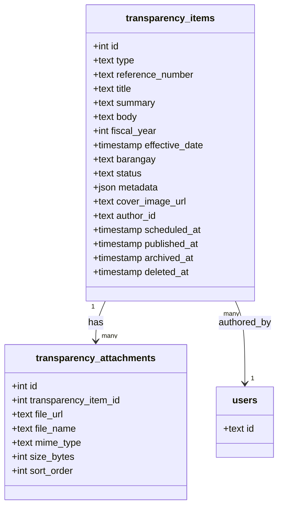

# Module 13 — Transparency and Good Governance

**Status:** New module proposal — extends file:docs/igubat_tor.md v3.1 to v3.2.  
**Source of truth for:** scope, role permissions, content types, lifecycles, fields, and acceptance criteria for the Transparency &amp; Good Governance surface added in this Epic.  
**Regulatory anchor:** Philippines **Full Disclosure Policy (DILG MC 2010-83 / FDPP)**, **RA 9184 (Government Procurement Reform Act)** for bids, **RA 7160 (Local Government Code)** for the Annual Budget and ordinances, and **RA 11032 (Ease of Doing Business)** for citizen access to government records.

---

## 1. Purpose

Give every constituent of the Municipality of Gubat, Sorsogon a single mobile entry point to find, read, and download **what the LGU is doing, what it is buying, how it spends, and what it has enacted** — fulfilling the LGU's Full Disclosure Policy obligations and embodying the "Know where your taxes go" promise shown to citizens on the mobile Home.

This module:

1. **Discloses operational records** (programs, procurement, finances, budget, ordinances, executive orders) to Guest and Authenticated User on mobile, *read-only*, *cached for offline*.
2. **Provides a Content Management surface** on the Web Administration Portal for Moderator (publish/schedule/archive) and Admin (permanent delete), reusing the canonical `Draft | Published | Archived` lifecycle already used by News and Discover Gubat.
3. **Notifies opted-in citizens** when a new transparency item is published (via the existing Notification module).

---

## 2. Scope — Six Content Types

All six surface on a single mobile section ("Transparency &amp; Good Governance") that lives on Home **above** the "Discover Latest News" section.


| #   | Content Type               | Mobile Tile              | What it discloses (FDPP equivalent)                                                                                                          |
| --- | -------------------------- | ------------------------ | -------------------------------------------------------------------------------------------------------------------------------------------- |
| 1   | **Program and Projects**   | `Program and Projects`   | LGU programs and projects (DILG project briefs): name, status, schedule, location/barangay, implementing office, beneficiaries, cost, photos |
| 2   | **Bids and Projects**      | `Bids and Projects`      | Procurement notices per RA 9184: Invitation to Bid, Request for Quotation, Award Notices — ABC, closing date, mode, awarded contractor       |
| 3   | **Financial Reports**      | `Financial Reports`      | SAOB, SRE, COA Annual Audit Report, Quarterly Financial Statements — PDFs with fiscal period                                                 |
| 4   | **Annual Budget**          | `Annual Budget`          | Annual budget, executive budget message, supplemental budgets, 20% Development Fund — by fiscal year, with total amount and PDF              |
| 5   | **Legislative Ordinances** | `Legislative Ordinances` | Sangguniang Bayan ordinances and resolutions — ordinance number, principal author, dates, full text                                          |
| 6   | **Executive Orders**       | `Executive Orders`       | Office of the Mayor Executive Orders — EO number, issuing official, dates, full text                                                         |


---

## 3. Roles &amp; Permissions

Aligned with the four canonical roles defined in file:docs/igubat_tor.md §5.


| Action                                                  | Guest | Authenticated User | Moderator | Admin |
| ------------------------------------------------------- | ----- | ------------------ | --------- | ----- |
| Open Transparency section on mobile Home                | ✓     | ✓                  | —         | —     |
| Browse list per content type                            | ✓     | ✓                  | —         | —     |
| Open item detail (text + download attachments)          | ✓     | ✓                  | —         | —     |
| Search/filter (by fiscal year, status, category)        | ✓     | ✓                  | —         | —     |
| Subscribe to "New transparency item" notifications      | —     | ✓                  | —         | —     |
| View Transparency CMS in admin portal                   | —     | —                  | ✓         | ✓     |
| Create / Edit transparency item (any of 6 types)        | —     | —                  | ✓         | ✓     |
| Upload attachments (PDF, JPG, PNG ≤ 10 MB, max 10/item) | —     | —                  | ✓         | ✓     |
| Save Draft / Schedule / Publish / Archive               | —     | —                  | ✓         | ✓     |
| Notify subscribers on publish (opt-in checkbox)         | —     | —                  | ✓         | ✓     |
| Permanently delete an item                              | —     | —                  | —         | ✓     |
| Export item list to CSV                                 | —     | —                  | —         | ✓     |


---

## 4. Lifecycle

The canonical content lifecycle already used by News (file:docs/igubat_tor.md §7.4) and Discover Gubat (file:docs/igubat_admin_portal.md §4.4d):

```
Draft ──► Scheduled ──► Published ──► Archived
   ▲          │            │            │
   └──────────┴────────────┴────────────┘  (revert allowed by Moderator/Admin)
```

- **Draft** — only visible in admin portal.
- **Scheduled** — system auto-publishes at `publishedAt`.
- **Published** — visible on mobile public surface; cacheable.
- **Archived** — removed from public lists; record retained; can be re-published.
- **Soft-delete** is the default for delete (30-day retention); Admin alone may force **permanent delete** with confirmation.

---

## 5. Common Item Fields (all 6 types)


| Field                                                   | Type                 | Notes                                                                                                                         |
| ------------------------------------------------------- | -------------------- | ----------------------------------------------------------------------------------------------------------------------------- |
| `id`                                                    | int (PK)             |                                                                                                                               |
| `type`                                                  | enum                 | one of: `program_project`, `bid_procurement`, `financial_report`, `annual_budget`, `legislative_ordinance`, `executive_order` |
| `referenceNumber`                                       | text                 | e.g. `IB-2026-014`, `EO No. 2026-05`, `Ord. No. 2026-018`                                                                     |
| `title`                                                 | text (required)      |                                                                                                                               |
| `summary`                                               | text                 | 1–2 paragraph plain-text excerpt                                                                                              |
| `body`                                                  | text                 | rich-text full content (markdown)                                                                                             |
| `fiscalYear`                                            | int (nullable)       | e.g. `2026`                                                                                                                   |
| `effectiveDate`                                         | timestamp (nullable) | for ordinances / EOs / bids                                                                                                   |
| `barangay`                                              | text (nullable)      | for projects scoped to a barangay                                                                                             |
| `status`                                                | enum                 | `draft | scheduled | published | archived`                                                                                    |
| `metadata`                                              | json                 | type-specific fields (see §6)                                                                                                 |
| `coverImageUrl`                                         | text (nullable)      | thumbnail for list view                                                                                                       |
| `authorId`                                              | text (FK → users.id) | the Moderator/Admin who created it                                                                                            |
| `scheduledAt`, `publishedAt`, `archivedAt`, `deletedAt` | timestamps           |                                                                                                                               |
| `createdAt`, `updatedAt`                                | timestamps           |                                                                                                                               |


---

## 6. Type-Specific Metadata Fields

Stored in the `metadata` JSON column. Validated by Zod per `type`.


| Type                      | Required type-specific fields                                                                                                                                                                                                                          |
| ------------------------- | ------------------------------------------------------------------------------------------------------------------------------------------------------------------------------------------------------------------------------------------------------ |
| **program_project**       | `projectStatus` (`planned | ongoing | completed | suspended`), `startDate`, `endDate?`, `costPhp` (numeric), `implementingOffice`, `beneficiaries?` (text), `locationAddress?`                                                                         |
| **bid_procurement**       | `approvedBudgetForContractPhp` (numeric), `procurementMode` (`public_bidding | small_value | shopping | negotiated`), `closingDate`, `awardedTo?` (text), `awardedAmountPhp?` (numeric), `bidStatus` (`posted | pre_bid | open | awarded | cancelled`) |
| **financial_report**      | `reportType` (`saob | sre | coa_annual | quarterly_financial_statement | other`), `fiscalPeriod` (text, e.g. `Q1 2026`), `preparedBy?`                                                                                                                 |
| **annual_budget**         | `budgetType` (`annual | supplemental | executive_budget`), `totalAmountPhp` (numeric), `endorsedBy?`                                                                                                                                                   |
| **legislative_ordinance** | `dateApproved`, `principalAuthor`, `sponsors?` (text), `sbSessionDate?`                                                                                                                                                                                |
| **executive_order**       | `dateIssued`, `issuedBy` (text, e.g. `Hon. <Mayor Name>`), `revokes?` (text — references EOs revoked)                                                                                                                                                  |


---

## 7. Attachments

A separate `transparency_attachments` table (mirrors `citizen_report_attachments`):

- `fileUrl`, `fileName`, `mimeType`, `sizeBytes`, `sortOrder`.
- Constraints: **max 10 attachments per item**, **≤ 10 MB per file**, MIME in `{application/pdf, image/jpeg, image/png}`.
- Reuses the existing **signed URL** + **virus scan** + **soft-delete** machinery from File and Media Management (file:docs/igubat_tor.md §11).

---

## 8. Mobile UX Behavior

- A new **"Transparency &amp; Good Governance"** section is added to the Home `CustomScrollView`, slotted **above** the news section. Subtitle: **"Know where your taxes go."**
- The section renders a **2×3 grid** of six `GlassCard` tiles — one per content type — with consistent iconography.
- Tap → category list screen, sorted **most recent first**, with filters: fiscal year (chip), status (for projects/bids), and a free-text search.
- Item detail screen shows: title, type-specific metadata band (e.g. "Ordinance No. 2026-018 · Approved 12 Mar 2026 · Effective 27 Mar 2026"), summary, full body, attachments list (tap to open via signed URL).
- The section is **public** (no auth required). The notification opt-in for "New transparency item" is gated behind sign-in.
- **Offline cache**: the latest 20 published items per content type, plus their attachment metadata, are cached. Attachment files themselves are downloaded on demand; previously-opened attachments remain in the cache. Cached items show a **"Last updated"** timestamp, consistent with §13 Offline Support.

---

## 9. Admin Portal UX Behavior

- A new sidebar entry **"Transparency"** is added to the **"Content &amp; Emergency"** group of file:apps/web/features/admin-layout/nav-items.ts, with `access: "staff"`.
- The portal surface is a **content list** with filters:
  - **Type** (one of six)
  - **Status** (`Draft | Scheduled | Published | Archived`)
  - **Fiscal year** (number input)
  - **Free-text search** (matches title, referenceNumber, summary).
- **Create / Edit** uses a wizard with a type selector → type-specific form (per §6) → attachments → publish controls (Save Draft, Schedule, Publish Now, with "Notify subscribers" checkbox).
- **Preview** opens the citizen-view rendering before publish.
- **Archive** removes from public lists; record retained.
- **Permanent Delete** — Admin only; requires confirmation modal; logged in audit.

---

## 10. Notification Integration

- A new notification category `transparency` is added to the existing `notifications.category` enum in file:packages/db/src/schema.ts and to `notificationPreferences`.
- On publish (when the "Notify subscribers" checkbox is checked), the Notification module fans out:
  - **In-app** to all opted-in Authenticated Users.
  - **Push** (FCM/APNs) to all opted-in Authenticated Users.
  - **Email** to all opted-in Authenticated Users.
- A deep link routes the notification tap to the corresponding mobile item detail.

---

## 11. Audit Logging

Every Create / Update / Status-Transition / Permanent-Delete / Subscriber-Notify on a transparency item writes an `audit_logs` entry with:

- `actorId`, `actionType` (e.g. `transparency.publish`), `entityType: "transparency_item"`, `entityId`, `details` (before/after snapshot of key fields), `ipAddress`.

---

## 12. Acceptance Criteria

1. Mobile Home renders the "Transparency &amp; Good Governance" section with six tiles in a 2×3 grid; subtitle reads "Know where your taxes go."
2. Each tile routes to a list screen filtered by its `type`.
3. List screen shows published items only, paginated, sorted by `publishedAt DESC`.
4. Item detail screen shows the type-specific metadata band and renders attachments via signed URLs.
5. Admin sidebar shows **Transparency** to Moderator and Admin; the route is reachable by both.
6. Moderator can Create / Edit / Save Draft / Schedule / Publish / Archive items of any type.
7. Admin can additionally Permanently Delete items; the action is logged.
8. Publishing with "Notify subscribers" checked dispatches push + in-app to all opted-in Authenticated Users.
9. Citizens can toggle the `transparency` notification category in their preferences.
10. Offline: previously-loaded list items are visible without connectivity; attachments require network unless previously opened.
11. All public endpoints are accessible without authentication; all admin endpoints require staff session and are rejected with 403 for citizen sessions and 401 for guests.
12. Audit log records every state transition.

---

## 13. Data Model (Logical ERD)



